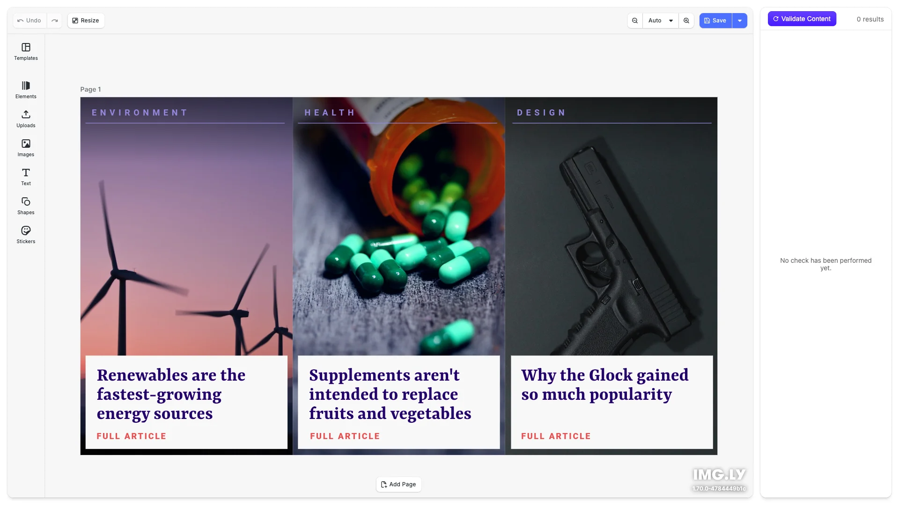

# Content Moderation Editor Starter Kit

Content moderation made easy. Check every image and text in a design and see which content might violate your guidelines. Built with [CE.SDK](https://img.ly/creative-sdk) by [IMG.LY](https://img.ly). The editor runs in the browser and checks content with the [IMG.LY Gateway](https://img.ly/dashboard).

<p>
  <a href="https://img.ly/docs/cesdk/js/starterkits/content-moderation-abc123/">Documentation</a>
</p>



## Getting Started

### Clone the Repository

```bash
git clone https://github.com/imgly/starterkit-content-moderation-react-web.git
cd starterkit-content-moderation-react-web
```

### Install Dependencies

```bash
npm install
```

### Download Assets

CE.SDK requires engine assets (fonts, icons, UI elements) served from your `public/` directory.

```bash
curl -O https://cdn.img.ly/packages/imgly/cesdk-js/$UBQ_VERSION$/imgly-assets.zip
unzip imgly-assets.zip -d public/
rm imgly-assets.zip
```

### Configure the IMG.LY Gateway

The starterkit checks content with the `imgly/detection` model on the IMG.LY Gateway at `https://gateway.img.ly`. To run a check:

1. Create an API key in the [IMG.LY dashboard](https://img.ly/dashboard).
2. Copy `.env.example` to `.env` and paste the key.

```bash
cp .env.example .env
```

```env
# API key from https://img.ly/dashboard
VITE_AI_API_KEY=sk_your_api_key_here
```

Without a key, or with a key the gateway rejects, the starterkit shows a setup screen instead of the editor.

> **Heads up.** The key is sent from the browser. That's fine for local development. For production, change `resolveAiToken` in `src/app/ai-credentials/ai-credentials.ts` to return a short-lived token minted by your backend — see [Gateway Provider](https://img.ly/docs/cesdk/js/user-interface/ai-integration/gateway-provider-06df22/) for the pattern.

A check sends each image URL and the words of each text block to the gateway. An image the gateway cannot download, such as an upload from the user's computer or an image on a private network address or a local host name, is rendered as a JPEG and uploaded first.

### Run the Development Server

```bash
npm run dev
```

Open `http://localhost:5173` in your browser.

## Export Check

Every export button runs the `exportDesign` action. `src/app/export-gate.ts` wraps it, so an export goes ahead without a question only when the last check covered every block, flagged nothing, and the design has not changed since. Otherwise the editor's warning dialog offers Moderate now, Export anyway and Cancel. To stop flagged designs from being exported at all, remove the Export anyway action there.

## Configuration

### Loading Content

Load content into the editor using one of these methods:

```typescript
// Create a blank design canvas
await cesdk.createDesignScene();

// Load from a template archive
await cesdk.load('https://example.com/template.zip');

// Load from a scene file
await cesdk.load('https://example.com/scene.json');

// Load from an image
await cesdk.createFromImage('https://example.com/image.jpg');
```

See [Open the Editor](https://img.ly/docs/cesdk/js/open-the-editor/load-scene-478833/) for all loading methods.

### Theming

```typescript
cesdk.ui.setTheme('dark'); // 'light' | 'dark' | 'system'
```

See [Theming](https://img.ly/docs/cesdk/js/user-interface/appearance/theming-4b0938/) for custom color schemes and styling.

### Localization

```typescript
cesdk.i18n.setTranslations({
  de: { 'common.save': 'Speichern' }
});
cesdk.i18n.setLocale('de');
```

See [Localization](https://img.ly/docs/cesdk/js/user-interface/localization-508e20/) for supported languages and translation keys.

## Architecture

```
src/
├── app/                          # Demo application
│   ├── ai-credentials/               # Gateway key, preflight check, setup screen
│   ├── App.tsx                       # Key check, then the editor and the sidebar
│   ├── components/Sidebar/           # Moderation results sidebar
│   ├── export-gate.ts                # Asks before exporting unconfirmed content
│   ├── gateway.ts                    # IMG.LY Gateway detection client
│   ├── moderation-button.ts          # "Moderate Content" navigation bar button
│   ├── moderation-session.ts         # Check state shared by sidebar and export
│   └── moderation.ts                 # Scene scan and category mapping
├── imgly/
│   ├── config/
│   │   ├── actions.ts                # Export/import actions
│   │   ├── features.ts               # Feature toggles
│   │   ├── i18n.ts                   # Translations
│   │   ├── plugin.ts                 # Main configuration plugin
│   │   ├── settings.ts               # Engine settings
│   │   └── ui/
│   │       ├── canvas.ts                 # Canvas configuration
│   │       ├── components.ts             # Custom component registration
│   │       ├── dock.ts                   # Dock layout configuration
│   │       ├── index.ts                  # Combines UI customization exports
│   │       ├── inspectorBar.ts           # Inspector bar layout
│   │       ├── navigationBar.ts          # Navigation bar layout
│   │       └── panel.ts                  # Panel configuration
│   └── index.ts                  # Editor initialization function
└── index.tsx                 # Application entry point
```

## Key Capabilities

- **Content Moderation** – Check images and text for inappropriate content
- **Policy Categories** – Nudity, weapons, drugs, alcohol, offensive symbols and gore in images; toxic, insulting, discriminatory, violent, sexual and self-harm language in text
- **Real-time Validation** – Validate designs from the sidebar or the "Moderate Content" button in the navigation bar
- **Export Check** – An export of a design that is not confirmed clean asks first, with Moderate now, Export anyway and Cancel
- **Block Selection** – Quickly navigate to flagged content
- **Full Design Editor** – Complete editing with text, images, and shapes
- **Export** – PNG and PDF

## Prerequisites

- **Node.js v22+** with npm – [Download](https://nodejs.org/)
- **Supported browsers** – Chrome 114+, Edge 114+, Firefox 115+, Safari 15.6+

## Troubleshooting

| Issue                              | Solution                                                   |
| ---------------------------------- | ---------------------------------------------------------- |
| Editor doesn't load                | Verify assets are accessible at `baseURL`                  |
| Assets don't appear                | Check `public/assets/` directory exists                    |
| Watermark appears                  | Add your license key                                       |
| Setup screen instead of the editor | Set `VITE_AI_API_KEY` in `.env` and restart the dev server |
| Some blocks "could not be checked" | The gateway failed for those blocks; run the check again   |
| Export asks before it starts       | Run the check again after your last change                 |

## Documentation

For complete integration guides and API reference, visit the [Content Moderation Editor Documentation](https://img.ly/docs/cesdk/js/starterkits/content-moderation-abc123/).

## License

This project is licensed under the MIT License - see the [LICENSE](LICENSE) file for details.

---

<p align="center">Built with <a href="https://img.ly/creative-sdk?utm_source=github&utm_medium=project&utm_campaign=starterkit-content-moderation-editor">CE.SDK</a> by <a href="https://img.ly?utm_source=github&utm_medium=project&utm_campaign=starterkit-content-moderation-editor">IMG.LY</a></p>
